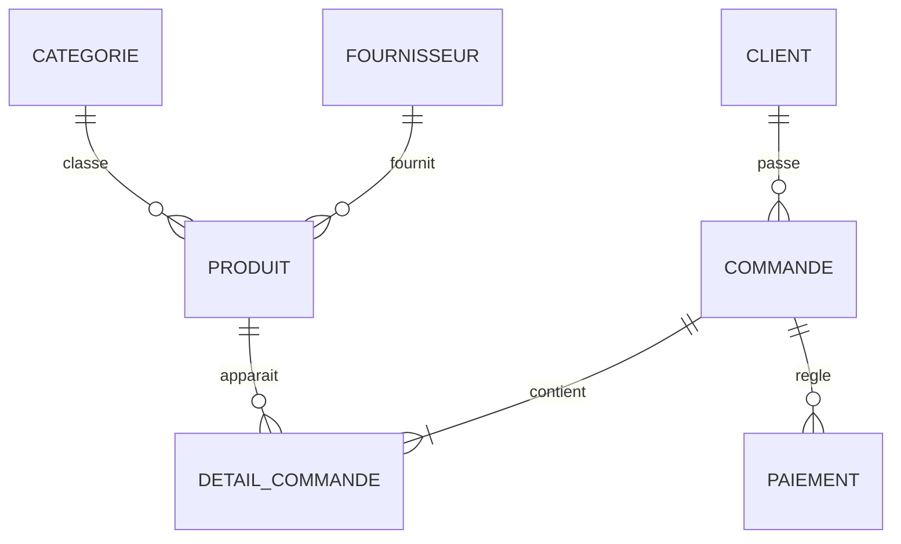

# Modèle Conceptuel de Données — TechStore

## 1. Présentation

Le Modèle Conceptuel de Données (MCD) décrit les informations nécessaires au fonctionnement de TechStore et les relations entre ces informations.

Il est indépendant du système de gestion de base de données utilisé.

## 2. Identification des entités

### CLIENT
Représente les personnes qui achètent des produits chez TechStore.

Attributs :
- id_client : identifiant du client
- nom_client : nom complet
- telephone : numéro de téléphone
- email : adresse électronique
- adresse : adresse du client

### FOURNISSEUR
Représente les entreprises qui approvisionnent TechStore.

Attributs :
- id_fournisseur : identifiant du fournisseur
- nom : nom du fournisseur
- telephone : numéro de téléphone

### CATEGORIE
Permet de classer les produits commercialisés.

Attributs :
- id_categorie : identifiant de la catégorie
- nom_categorie : nom de la catégorie

### PRODUIT
Représente les articles disponibles à la vente.

Attributs :
- id_produit : identifiant du produit
- nom_produit : désignation du produit
- prix : prix actuel
- stock : quantité disponible

### COMMANDE
Représente une commande effectuée par un client.

Attributs :
- id_commande : identifiant de la commande
- date_commande : date de création
- etat : état de la commande

### PAIEMENT
Représente un règlement effectué par un client pour une commande.

Attributs :
- id_paiement : identifiant du paiement
- montant : montant versé
- date_paiement : date du règlement
- mode_paiement : moyen de paiement utilisé

## 3. Associations et cardinalités

| Association | Première entité | Deuxième entité |
|---|---|---|
| PASSER | CLIENT (0,N) | COMMANDE (1,1) |
| FOURNIR | FOURNISSEUR (0,N) | PRODUIT (1,1) |
| CLASSER | CATEGORIE (0,N) | PRODUIT (1,1) |
| CONTENIR | COMMANDE (1,N) | PRODUIT (0,N) |
| REGLER | COMMANDE (0,N) | PAIEMENT (1,1) |

L'association CONTENIR possède les attributs :
- quantite
- prix_unitaire

## 4. Justification des cardinalités

- Un client peut ne passer aucune commande ou en passer plusieurs.
- Une commande appartient obligatoirement à un seul client.
- Un fournisseur peut fournir plusieurs produits.
- Dans la version actuelle, chaque produit possède un seul fournisseur.
- Une catégorie peut regrouper plusieurs produits.
- Chaque produit appartient à une seule catégorie.
- Une commande contient au moins un produit.
- Un produit peut apparaître dans plusieurs commandes.
- Une commande peut ne recevoir aucun paiement ou en recevoir plusieurs.
- Chaque paiement est associé à une seule commande.

## 5. Représentation conceptuelle simplifiée

DETAIL_COMMANDE représente l'association porteuse d'attributs entre COMMANDE et PRODUIT. Elle devient une entité associative dans le modèle relationnel.

## 6. Conclusion

Le MCD permet de représenter les besoins métier de TechStore avant leur traduction en tables relationnelles. Il constitue la base de la conception de la base de données.

